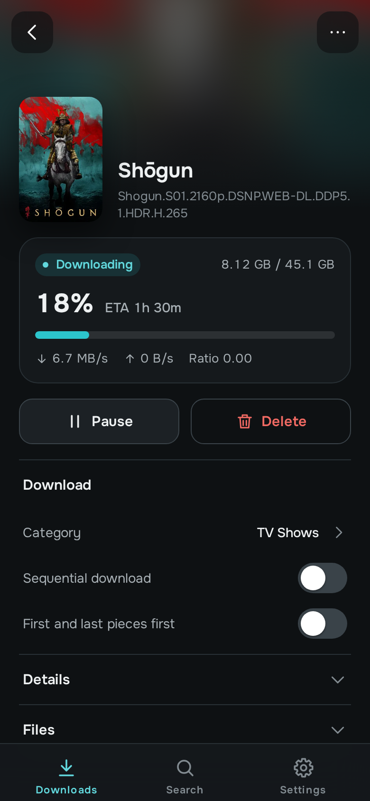

# Kinopeer

[](https://github.com/kinopeer/kinopeer/actions/workflows/ci.yml)
[](LICENSE)
[](https://github.com/kinopeer/kinopeer/releases/latest)

A qBittorrent web UI for movies and TV series. Find a movie or a series, pick a release found by Prowlarr and follow the download, all in one app on your phone or computer.

> [!NOTE]
> Kinopeer installs [on umbrelOS](#install-on-umbrel), [with Docker Compose](#install-with-docker-compose) beside qBittorrent and Prowlarr, [next to the qBittorrent and Prowlarr you already run](#install-next-to-your-own-qbittorrent-and-prowlarr), TrueNAS, CasaOS and Unraid among them, or [as qBittorrent's Alternative WebUI](#install-as-qbittorrents-alternative-webui), with no server of its own. [Ways to install](#ways-to-install) compares them. What's planned is in the [milestones](https://github.com/kinopeer/kinopeer/milestones).

<p align="center"></p>


<details>
<summary>More screenshots</summary>

<p>
  
  
  
</p>
<p>
  
  
  
</p>


</details>

## What it does

- **From a title to a release.** Find a movie or a series in TMDB, and Kinopeer searches every indexer in your Prowlarr. It reads each release's name for its resolution, source, HDR, voice-over and seasons, so the filters narrow the list down to the one you want.
- **Download only what you need.** The release goes to qBittorrent with your category and folder. Pick single files or seasons, and Kinopeer tells you beforehand whether they fit in the free space.
- **Downloads as a film collection.** Kinopeer recognizes each torrent's movie or series from its release name and shows it with a poster and a title instead of the release name; a wrong guess takes a moment to correct. A title's page shows what of it is downloading.
- **Managing torrents.** What you actually need when downloading movies and series, without opening qBittorrent's web UI: pause and delete, several torrents at once too, file priorities, speed limits, moving files, categories.
- **Know when it's done.** Kinopeer can send you a push notification, or a Telegram message through a bot of your own, when a download you marked finishes.
- **Phone and computer.** A comfortable interface that fits both a phone and a computer. Multilingual, with dark and light themes.

Kinopeer doesn't play video and never downloads anything on its own: you pick every release.

Kinopeer comes with no content and no indexers: it searches only the indexers you add to Prowlarr yourself. Use it only for what you have the right to download.

## Ways to install

Every install runs the same app. They differ in what they need and in what only Kinopeer's own server can do; each install's section has the details.

| Install | What it needs | Notifications | Login | TMDB | Where settings live | Updating |
| --- | --- | --- | --- | --- | --- | --- |
| [Umbrel](#install-on-umbrel) | umbrelOS with its qBittorrent and Prowlarr apps | Push (over HTTPS) and Telegram | Umbrel's | Kinopeer's key, or your own | On your Umbrel | Umbrel offers it |
| [Docker Compose](#install-with-docker-compose) | Docker with Compose; the file brings qBittorrent and Prowlarr | Push (over HTTPS) and Telegram | Kinopeer's own password | Kinopeer's key, or your own | Kinopeer's Docker volume | `docker compose pull`, then `up -d` |
| [Next to your own qBittorrent and Prowlarr](#install-next-to-your-own-qbittorrent-and-prowlarr), [TrueNAS](#truenas), [Unraid](#unraid), [CasaOS](#casaos-and-zimaos) | Docker, qBittorrent 4.6.0 or later and Prowlarr | Push (over HTTPS) and Telegram | Kinopeer's own password | Kinopeer's key, or your own | Kinopeer's Docker volume (Unraid: its appdata folder; TrueNAS: an ixVolume or a folder you pick) | Pull the image, then a new container (TrueNAS: its Apps page offers it) |
| [qBittorrent's Alternative WebUI](#install-as-qbittorrents-alternative-webui) | qBittorrent 5.2.0 or later and Prowlarr; no Docker | None ([qBittorrent's e-mail](#what-the-alternative-webui-doesnt-have)) | qBittorrent's | Kinopeer's key at a home-network address, else your own | In qBittorrent, shared by every browser | Unpack the new zip over the old |

## Install on Umbrel

It needs the **qBittorrent** and **Prowlarr** apps from the Umbrel App Store. It works with qBittorrent 4.6.0 or later.

1. Open **App Store** → the **⋯** menu at the top right → **Community App Stores**.
2. Paste `https://github.com/MrShakhov/umbrel-homelab-store` → **Add**.
3. Open **Homelab App Store** → **Kinopeer** → **Install**.
4. Kinopeer opens at `http://umbrel.local:8797`.

On first launch:

- **qBittorrent** connects on its own with Umbrel's default login. If you changed it, Kinopeer asks for the login once and keeps it on your Umbrel.
- **TMDB** needs no setup: Kinopeer uses its own key. You can enter your own free [TMDB API key](https://www.themoviedb.org/settings/api) in Settings; it's kept on your Umbrel, and TMDB calls then go to TMDB directly.
- **Prowlarr** needs no setup: Kinopeer reads its API key itself. Trackers are added as indexers in Prowlarr.

Umbrel offers updates when a new version is out. What changed is in [CHANGELOG.md](CHANGELOG.md).

## Install with Docker Compose

> [!NOTE]
> This works from Kinopeer 1.1.0, the first version with a password of its own.

Kinopeer's [`docker-compose.yml`](docker-compose.yml) runs Kinopeer beside **qBittorrent** (the qBittorrent project's own image) and **Prowlarr** (LinuxServer.io's image, which Prowlarr's wiki points to), each in a container of its own. It needs Docker with Compose.

1. In an empty folder, download the file from the latest release, make the folder for downloads and start it:

   ```bash
   curl -LO https://github.com/kinopeer/kinopeer/releases/latest/download/docker-compose.yml
   ```

   ```bash
   mkdir downloads
   ```

   ```bash
   docker compose up -d
   ```

2. Open Kinopeer at `http://<your server>:8797` right away and set its password: until then, whoever opens it first sets it. To set it beforehand, put `KINOPEER_PASSWORD='…'` with a password of 8 characters or more in a `.env` file next to `docker-compose.yml`, in single quotes, so that Compose keeps a `$` in it as it is.
3. Open Prowlarr at `http://<your server>:9696`, set up its login and add your indexers. Kinopeer reads Prowlarr's API key itself.

qBittorrent and TMDB need no setup. Downloads go into that `downloads` folder, `/downloads` inside qBittorrent, where Settings → qBittorrent folders sets qBittorrent's folders, and belong to whoever owns it, you when you made it. Should Docker make it instead, it's root's, and qBittorrent writes as user 1000 rather than as root. Rootless Docker and Podman show your own folder as root's too: there, put `PUID=0` and `PGID=0` in the `.env` file, which they map to you. The file confirms qBittorrent's legal notice for you, which qBittorrent asks for before it starts.

**qBittorrent trusts Kinopeer without a password, and nothing else.** On its first start, the file sets qBittorrent up to let in Kinopeer's container, at its fixed address `172.30.97.10`, without a password, so you don't need the temporary one qBittorrent makes up on every start until a password is set. Everyone else needs a password, and qBittorrent's own web UI isn't reachable from outside Docker. To have qBittorrent ask Kinopeer for a password too:

1. Uncomment the `8081:8080` line under `qbittorrent` in `docker-compose.yml`, run `docker compose up -d` and open `http://<your server>:8081`.
2. Sign in as `admin` with the temporary password from `docker compose logs qbittorrent`.
3. In **Tools → Options → Web UI**, set a password and turn off **Bypass authentication for clients in whitelisted IP subnets**.
4. Kinopeer then asks for qBittorrent's login once and keeps it.

**Settings**, all optional, go into the `.env` file:

| Variable | Default | What it sets |
| --- | --- | --- |
| `KINOPEER_PORT`, `PROWLARR_PORT` | `8797`, `9696` | Kinopeer's and Prowlarr's ports |
| `DOWNLOADS_DIR` | `./downloads` | The folder downloads go into |
| `KINOPEER_PASSWORD` | none | Kinopeer's password, in place of one set in the app |
| `KINOPEER_ALLOWED_HOSTS` | none | Names Kinopeer answers at besides the ones it answers at by default, such as a reverse proxy's domain ([which those are, and its rules](docs/DEVELOPMENT.md#server-configuration)) |

If `docker compose up` says the network's range overlaps another, change the range `172.30.97.0/24`, the part of it Docker gives the other containers (`172.30.97.128/25`) and Kinopeer's address `172.30.97.10`, in both places it's written, in `docker-compose.yml` before the first start. Keep Kinopeer's address in the range and out of that part.

**Updating:** `docker compose pull`, then `docker compose up -d`. Kinopeer's image follows the newest 1.x release, qBittorrent's and Prowlarr's their newest releases. A release that changes `docker-compose.yml` says so in [CHANGELOG.md](CHANGELOG.md); download it again then, keeping your `.env`.

**HTTPS** is up to a reverse proxy in front of Kinopeer, which this file doesn't include; here's an example, not a setup we support. Kinopeer answers only at names it knows, so add the proxy's domain to `KINOPEER_ALLOWED_HOSTS` (`KINOPEER_ALLOWED_HOSTS=kinopeer.example.com`), and have the proxy pass on the name the page was opened at, as Caddy does. With the proxy on the same machine, `KINOPEER_PORT=127.0.0.1:8797` keeps Kinopeer's own port to that machine, so it isn't also open over plain HTTP:

```
kinopeer.example.com {
	reverse_proxy localhost:8797
}
```

## Install next to your own qBittorrent and Prowlarr

> [!NOTE]
> This works from Kinopeer 1.1.0, the first version that asks for their addresses itself.

If you already run qBittorrent (4.6.0 or later) and Prowlarr, in Docker, installed on the machine itself, on another computer or on a seedbox, run Kinopeer's image on its own and give it their addresses in the app. It needs Docker.

1. Start Kinopeer:

   ```bash
   docker run -d --name kinopeer --restart unless-stopped -p 8797:8080 -v kinopeer-data:/data ghcr.io/kinopeer/kinopeer:1
   ```

   Or with Compose, this `docker-compose.yml` in a folder of its own, then `docker compose up -d`:

   ```yaml
   name: kinopeer
   services:
     kinopeer:
       image: ghcr.io/kinopeer/kinopeer:1
       restart: unless-stopped
       ports:
         - "8797:8080"
       volumes:
         - kinopeer-data:/data
   volumes:
     kinopeer-data:
   ```

   Kinopeer listens at port 8080 inside its container; `8797` is the port you open it at. The `kinopeer-data` volume keeps its password, the addresses and logins you enter and its settings across updates.
2. Open Kinopeer at `http://<your server>:8797` right away and set its password: until then, whoever opens it first sets it. To set it beforehand, add `-e KINOPEER_PASSWORD='…'` (`KINOPEER_PASSWORD` under `environment:` in Compose, where a `$` in it is written `$$`) with a password of 8 characters or more.
3. Kinopeer asks for qBittorrent's address and login, then for Prowlarr's address and API key, which you find in Prowlarr under Settings → General → Security → API Key. Each address is the one Kinopeer's container reaches the service at (below). The server checks each before keeping it. You can skip Prowlarr and add it later, from a title's releases or Settings → Connections; everything but finding releases works without it. Settings → Connections changes either address later.

The addresses can also come from the server's environment, `QBITTORRENT_URL` and `PROWLARR_URL` with the other variables in [DEVELOPMENT.md](docs/DEVELOPMENT.md#server-configuration); an address set there wins, and the app doesn't ask for it.

**Which address to enter.** Find, under the address field, has Kinopeer's server look at the names these containers usually have, the computer it runs on and its own network, on the services' default ports, and offers what answered; it can't find one on another port, behind a URL base or on another network. Inside Kinopeer's container, `localhost` and `127.0.0.1` lead into the container itself, not to your server. Otherwise use one of these, with the port the service's web UI answers at:

- The machine's address on your network, such as `http://192.168.1.10:8080`: for a qBittorrent or Prowlarr anywhere on your network, the same machine included, and a seedbox's address the same way.
- `http://host.docker.internal:8080` for one on the same machine: Docker Desktop has that name; on Linux, add `--add-host=host.docker.internal:host-gateway` to `docker run` (`extra_hosts: ["host.docker.internal:host-gateway"]` in Compose).
- The container's name, such as `http://qbittorrent:8080`, at the port inside its container, for one in Docker on a network of your own that Kinopeer's container joins too: Docker resolves names only on such a network, not on its default `bridge`, where a container started with plain `docker run` sits. Make one with `docker network create media` and start qBittorrent, Prowlarr and Kinopeer each with `--network media` (`docker network connect media qbittorrent` puts a running container on it at once, until that container is made anew, as an update does). In Compose, each file joins it by declaring it `external`:

  ```yaml
  services:
    kinopeer:
      networks:
        - media
  networks:
    media:
      external: true
  ```

- With `--network host` (Linux), Kinopeer shares the machine's network, so `localhost` is the machine. Kinopeer then listens at 8080 itself, the port qBittorrent's web UI often has: add `-e PORT=8797` and leave out `-p` (in Compose, `network_mode: host`, `PORT: "8797"` under `environment:` and no `ports:`).

**When it doesn't connect:**

- **"Nothing listens on this port", "Nothing answered in time" or "Nothing answers at this address."** The first says nothing took the connection, the second that nothing answered at all, and the last that Kinopeer's server couldn't tell why. Check that the service is running, the address and the port. On Linux, a qBittorrent or Prowlarr that listens only on 127.0.0.1 isn't reachable from Kinopeer's container, unless Kinopeer runs with `--network host` (and through Docker Desktop's `host.docker.internal` it is): in qBittorrent, Tools → Options → Web UI → IP address set to `*`; in Prowlarr, Settings → General → Bind Address set to `*`. A firewall on the machine (ufw, firewalld) may also drop what comes from Docker's network: allow it to the port.
- **"qBittorrent's address answers, but not like qBittorrent."** The port is another program's; at `localhost:8080` without `--network host`, it's Kinopeer itself.
- **"qBittorrent refused this address."** qBittorrent's Host header validation (Tools → Options → Web UI) refuses a request whose address has another port than its own web UI's, as when Docker publishes its 8080 as 8081 and Kinopeer is given `:8081`, or a name missing from its Server domains. Give the port qBittorrent itself listens at (the container's name and its own port), publish it at the same port, add the name to Server domains, or turn the validation off.
- **qBittorrent asks for a login you didn't set.** qBittorrent 4.6.1 and later have no password at first and make up a temporary one on every start, in qBittorrent's log. Set a password of your own in qBittorrent's web UI and enter that in Kinopeer, rather than relying on qBittorrent's bypasses (Tools → Options → Web UI). Under Docker, Kinopeer's requests reach qBittorrent from an address that other containers and programs on the machine share (a container's, a Docker network's gateway, or the machine's loopback `127.0.0.1`), so a bypass that lets Kinopeer in lets them in too. A qBittorrent on another computer or a seedbox sees the Docker machine's address (over the internet, your network's public one), shared the same way by everything else on that machine.

**Prowlarr's key without entering it.** With Prowlarr's config folder on the same machine, Kinopeer can read the key from Prowlarr's `config.xml` itself, as on Umbrel: mount the folder read-only and set Prowlarr's address in the environment, since the key is read only with it. With `docker run`, add (with your folder in place of `/path/to/prowlarr/config`):

```bash
-e PROWLARR_URL=http://<Prowlarr's address>:9696 -e PROWLARR_CONFIG_XML=/prowlarr/config.xml -v /path/to/prowlarr/config:/prowlarr:ro
```

Mount the folder, not the file: a file mount would keep the old file after Prowlarr rewrites it. Kinopeer runs as user 1000, which needs to be able to read the file.

**Updating:** `docker pull ghcr.io/kinopeer/kinopeer:1`, then remove the container (`docker rm -f kinopeer`) and run the same `docker run` again; or, with Compose, `docker compose pull`, then `docker compose up -d`. The `:1` tag follows the newest 1.x release, and the volume keeps what you set up. What changed is in [CHANGELOG.md](CHANGELOG.md).

**Names and HTTPS.** Kinopeer answers at your server's IP address, `localhost`, `.local` names, names of one label and the other private names in [DEVELOPMENT.md](docs/DEVELOPMENT.md#server-configuration). Any other name, such as `nas.lan` from your router or a reverse proxy's domain for HTTPS, goes into `KINOPEER_ALLOWED_HOSTS`: `-e KINOPEER_ALLOWED_HOSTS=kinopeer.example.com` with `docker run`, `KINOPEER_ALLOWED_HOSTS: kinopeer.example.com` under `environment:` in Compose. With a proxy installed on the machine itself, publish Kinopeer's port to that machine alone, `-p 127.0.0.1:8797:8080` (`"127.0.0.1:8797:8080"` under `ports:`), so it isn't also open over plain HTTP. A proxy in a container of its own (Nginx Proxy Manager, Caddy in Docker) can't reach the machine's loopback: put it and Kinopeer on a network of your own, as above, point it at `http://kinopeer:8080`, and leave out `-p` (`ports:` in Compose). Without a published port, `http://<your server>:8797` doesn't answer, so set `KINOPEER_PASSWORD` beforehand (step 2), or set the password before taking the port away: otherwise whoever first opens the proxy's domain sets it. Either way, have the proxy pass on the name the page was opened at, as Caddy does in the example under **HTTPS** in [Install with Docker Compose](#install-with-docker-compose) (in a container, with `kinopeer:8080` in place of `localhost:8797`).

### TrueNAS

TrueNAS Community Edition 24.10 and later has Kinopeer in its apps catalog:

1. Open **Apps** → **Discover Apps**, search for **Kinopeer** and install it. The defaults open it at port 30624 and keep its data in an ixVolume; a host path you pick instead must be writable by TrueNAS's `apps` user. Kinopeer runs as that user and group (568:568) by default.
2. Open Kinopeer at `http://<your TrueNAS>:30624` and set its password right away; or set **Password** in the install form beforehand, which then changes only in the app's settings on TrueNAS, not in Kinopeer.
3. Kinopeer asks for qBittorrent's address and login, then Prowlarr's address and API key, as in step 3 of [Install next to your own qBittorrent and Prowlarr](#install-next-to-your-own-qbittorrent-and-prowlarr). The install form also takes both addresses up front: Kinopeer then asks only for qBittorrent's login and Prowlarr's key, and an address set there, like the password, changes only in the app's settings on TrueNAS. A variable that the sections above give for `docker run` and Compose, such as `KINOPEER_ALLOWED_HOSTS` for a name like `nas.lan`, goes under **Additional Environment Variables** in that form.

TrueNAS's own qBittorrent and Prowlarr apps answer at your TrueNAS's address with the ports they're installed with, by default `http://<your TrueNAS>:30024` for qBittorrent and `http://<your TrueNAS>:30050` for Prowlarr. The qBittorrent app writes its temporary password in its logs at first: set a password of your own in its web UI first.

Each Kinopeer release reaches the catalog once TrueNAS's maintainers merge its automatic update; TrueNAS then offers it on its **Apps** page.

Or install the Compose file above as a custom app (24.10 and later): **Apps** → **Discover Apps**, the **⋮** menu next to **Custom App** → **Install via YAML**, `kinopeer` as the name, the Compose file under **Custom Config**, **Save**; then open Kinopeer at `http://<your TrueNAS>:8797` and go on from step 2 of [Install next to your own qBittorrent and Prowlarr](#install-next-to-your-own-qbittorrent-and-prowlarr).

### Unraid

> [!NOTE]
> This works from Kinopeer 1.2.0, the first version with Find.

1. Open the **Apps** tab, search for **Kinopeer** and install it. The defaults open it at port 8797 and keep its data in `/mnt/user/appdata/kinopeer`. Kinopeer runs as Unraid's usual user and group, `nobody:users` (99:100), which own that folder.
2. Open Kinopeer from its icon in the **Docker** tab (WebUI), or at `http://<your Unraid>:8797`, and set its password right away; or set **Password** in the template beforehand.
3. Kinopeer asks for qBittorrent's address and login, then Prowlarr's address and API key. Enter your server's address with the port the Docker tab shows under **LAN IP:Port**, such as `http://192.168.1.10:8080` for qBittorrent or `http://192.168.1.10:9696` for Prowlarr: it stays the same when Unraid recreates a container, as an update does. **Find**, under each address field, looks on Unraid's Docker network too, where qBittorrent's and Prowlarr's containers are with Unraid's default network; it may offer a container's own address there (the Docker tab's **Container IP** column), which can change when the container is recreated.

The template's advanced view (**Show more settings**) also takes the addresses up front, then the app doesn't ask for them. Kinopeer can read Prowlarr's key itself, as **Prowlarr's key without entering it** above says, with three of its fields set: **Prowlarr address**, **Prowlarr config folder** (Prowlarr's appdata folder, usually `/mnt/user/appdata/prowlarr`) and **Prowlarr config file**, `/prowlarr/config.xml`. On Unraid Kinopeer runs as 99:100 rather than 1000, so that's who needs to be able to read the file.

### CasaOS and ZimaOS

CasaOS installs a Docker Compose file as a custom app:

1. On the dashboard, press **+** next to **Apps** → **Install a customized app**, then the import icon at the top right.
2. On the **Docker Compose** tab, paste the Compose file above, press **Submit**, then **Install**. CasaOS imports only the first service of a file, and Kinopeer's is the only one.
3. Open Kinopeer at `http://<your CasaOS>:8797` and go on from step 2 above.

The qBittorrent and Prowlarr apps from CasaOS's App Store answer at `http://<your CasaOS>:8181` and `http://<your CasaOS>:9696`. qBittorrent's login is `admin` with the temporary password in its log, until you set one of your own in its web UI. To have Kinopeer read Prowlarr's key itself, add to the Compose file, under `kinopeer:`:

```yaml
    environment:
      PROWLARR_URL: http://<your CasaOS>:9696
      PROWLARR_CONFIG_XML: /prowlarr/config.xml
```

and under its `volumes:`, `- /DATA/AppData/prowlarr/config:/prowlarr:ro`.

ZimaOS installs apps from your own Docker Compose file too, and the same file and addresses apply.

## Install as qBittorrent's Alternative WebUI

> [!NOTE]
> This works from Kinopeer 1.3.0, the first release with `kinopeer-webui.zip`.

qBittorrent can serve another web interface in place of its own, and Kinopeer comes as one too: qBittorrent serves it at qBittorrent's own address, with no Docker and no server of Kinopeer's, wherever qBittorrent runs. It needs qBittorrent 5.2.0 or later with its Web UI on, which keeps Kinopeer's settings for every browser that signs in to it, and Prowlarr for finding releases. Without a server of its own Kinopeer can't send notifications or have a login of its own: [what it doesn't have](#what-the-alternative-webui-doesnt-have).

1. Download `kinopeer-webui.zip` from the latest release and unpack it on the machine qBittorrent runs on, where qBittorrent can read it:

   ```bash
   curl -LO https://github.com/kinopeer/kinopeer/releases/latest/download/kinopeer-webui.zip
   ```

   ```bash
   unzip kinopeer-webui.zip
   ```

   That makes a `kinopeer-webui` folder. For qBittorrent in Docker, unpack it into a folder you mount into qBittorrent's container, such as `-v /path/to/webui:/webui:ro` with `docker run` (`- /path/to/webui:/webui:ro` under its `volumes:` in Compose).
2. In qBittorrent's web UI, open **Tools → Options… → WebUI** and set the options Kinopeer has no screen for, above all the session timeout (below). Then turn on **Use alternative WebUI**, set **Files location** to the `kinopeer-webui` folder as qBittorrent sees it (`/webui/kinopeer-webui` in the container above) and **Save**. The desktop app has the same settings under Tools → Options → Web UI.
3. Reload qBittorrent's address: Kinopeer asks for qBittorrent's login, unless this browser is signed in to it already, then for a TMDB key where it needs one (below), then for Prowlarr's address and API key, which you find in Prowlarr under Settings → General → Security → API Key. The address has to be one both this browser and qBittorrent reach Prowlarr at, such as the machine's network address, `http://192.168.1.10:9696`: the browser calls Prowlarr itself, and qBittorrent fetches some releases' links from Prowlarr at the same address. So `localhost` works only with qBittorrent on this device and outside a container. Find, under the address field, tries Prowlarr's port at qBittorrent's machine and at the name `prowlarr`, over plain HTTP, so with qBittorrent opened over HTTPS it tries only this device. You can skip Prowlarr and add it later, from a title's releases or Settings → Connections.

**qBittorrent's session timeout.** qBittorrent signs a browser out after its **Session timeout** without a request (Tools → Options… → WebUI → Authentication), an hour by default, and Kinopeer then asks for the login again. Raise it to how long you'd like to stay signed in.

**TMDB.** Kinopeer's own TMDB key answers only a page at a home-network address: an IP address in a private range, `localhost`, a `.local`, `.home.arpa` or `.internal` name, or a name of one label. Opened at any other name, such as a seedbox's or a reverse proxy's domain, Kinopeer asks for your own free [TMDB API key](https://www.themoviedb.org/settings/api), which qBittorrent keeps.

**When it doesn't open or connect:**

- **qBittorrent answers "Unauthorized" to everything, its own page too.** qBittorrent's Host header validation refuses an address with another port than its own Web UI's, as when Docker publishes the container's 8080 as 8081 (`-p 8081:8080`). Publish it at the same port (`-p 8080:8080`), or move qBittorrent's own port to the one you publish (`QBT_WEBUI_PORT` in the qBittorrent project's image), or turn off **Enable Host header validation** in Tools → Options… → WebUI.
- **Kinopeer refuses Prowlarr's `http://` address.** A page opened over HTTPS can't call a plain HTTP address, so with qBittorrent over HTTPS, Prowlarr needs an HTTPS address too (its own HTTPS or a reverse proxy), with a certificate this browser trusts: open that address in the browser once to check. Only an address on this device (`localhost`) is let through over plain HTTP, and it serves only a qBittorrent on this device outside a container (step 3), so Prowlarr's network address needs HTTPS too. Or open qBittorrent over plain HTTP on your home network.
- **Behind a reverse proxy,** serve qBittorrent at the root of a name of its own (`https://qbittorrent.example.com/`), not under a path: Kinopeer's page loads its files from `/`.

**The way back to qBittorrent's own interface.** While Kinopeer is on, qBittorrent's address shows Kinopeer. To switch, open **Settings → About → Switch to qBittorrent's interface** in Kinopeer (or the same button on the screen saying qBittorrent is too old) and confirm: Kinopeer turns off **Use alternative WebUI**, and qBittorrent's own interface opens at the same address, on every device. qBittorrent's desktop app has the same setting under Tools → Options → WebUI. To bring Kinopeer back, turn **Use alternative WebUI** on again in qBittorrent's **Tools → Options… → WebUI** and **Save**: the folder stays set. If Kinopeer's page doesn't work at all, open the browser's developer tools on qBittorrent's address in a browser that signed in to qBittorrent through Kinopeer before (its session lasts the session timeout), and in their **Console** run

```js
fetch('api/v2/app/setPreferences', { method: 'POST', body: new URLSearchParams({ json: '{"alternative_webui_enabled":false}' }) })
```

and reload. Moving or deleting the `kinopeer-webui` folder doesn't reliably bring qBittorrent's interface back.

**Updating:** download the new `kinopeer-webui.zip` and unpack it over the old folder (`unzip -o kinopeer-webui.zip`); open pages reload into the new version by themselves. New versions are on the [releases page](https://github.com/kinopeer/kinopeer/releases), what changed in [CHANGELOG.md](CHANGELOG.md).

### What the Alternative WebUI doesn't have

Each of these needs Kinopeer's own server, which this install does without:

- **Notifications.** Kinopeer sends no push or Telegram notifications here. qBittorrent can e-mail you instead when a download finishes: Tools → Options… → Downloads → **Email notification upon download completion**.
- **A login of Kinopeer's own.** qBittorrent's login is the login, with qBittorrent's ban after wrong passwords.
- **qBittorrent's address in the app.** Kinopeer is on qBittorrent's own address, so there's none to set or find.
- **Keys kept from the browser.** The browser calls TMDB and Prowlarr itself, so it holds their keys, which qBittorrent keeps: anyone with qBittorrent's login or a browser extension on the page can read them. Keep Prowlarr on your home network, over HTTPS where you can.

## On your phone

Kinopeer is a web app (PWA). Over plain HTTP on your home network it works in the browser, and on an iPhone or iPad you can add it to the Home Screen from Safari's Share menu to open it full screen. umbrelOS 2.0 also serves it over HTTPS (`https://umbrel.local:8797`): with the Umbrel certificate trusted on your device ([Umbrel's guide](https://umbrel.com/support/basics/accessing-your-umbrel-over-https)), Kinopeer installs as an app on Android and computers too and keeps its shell available offline. Umbrel renews that certificate every month: if your browser trusts it only because you accepted its warning (Safari's "Visit Website") rather than installing it, the installed app says it can't reach Kinopeer once the certificate changes, and **Open again** brings back the browser's warning to accept the new one.

As qBittorrent's Alternative WebUI, Kinopeer installs as an app the same way when qBittorrent is opened over HTTPS with a certificate your device trusts.

Push notifications need that HTTPS address with the certificate trusted on your device, as Umbrel's guide says, and on an iPhone or iPad, Kinopeer added to the Home Screen from it: Safari gives push only to Home Screen apps. Turn them on for each device in Settings → Connections → Push notifications, which says what's missing when a device can't get them.

## Privacy and security

- The TMDB and Prowlarr keys, the qBittorrent login and a Telegram bot's token stay on the Kinopeer server and never reach the browser. As qBittorrent's Alternative WebUI there's no Kinopeer server: qBittorrent keeps the keys and the browser uses them, as [what it doesn't have](#what-the-alternative-webui-doesnt-have) says.
- Besides your qBittorrent and Prowlarr, Kinopeer only talks to TMDB, and only through its own server (as the Alternative WebUI, from the browser). Without a TMDB key of your own, those calls go through Kinopeer's TMDB proxy on Cloudflare, which adds Kinopeer's key and sees your server's IP address (the browser's, as the Alternative WebUI) and what you search for. The proxy itself keeps no logs; Cloudflare's analytics for its domain keep each request's IP address, country, path (a title's number when one is looked up, not a search's words), answer and `User-Agent` for 31 days, which only Kinopeer's maintainers can read. With your own key in Settings, they go to TMDB directly. Posters and backdrops come from TMDB's image server either way, loaded by the server itself, or as the Alternative WebUI by the browser, so TMDB sees that IP address and the titles opened. Kinopeer's server names its version in each of its calls to TMDB, the proxy and the image server (`User-Agent: Kinopeer/1.4.0`, say), and nothing about your install; the Alternative WebUI's calls carry the browser's own. Counted by it, the proxy's requests tell Kinopeer's maintainers when no one runs an old version any more and the paths only it calls can go. With Telegram notifications set up, the server also sends Telegram the finished download's title and release name. With push notifications on, it sends them through the push service of each device's browser (Google's, Mozilla's, Apple's or Microsoft's), encrypted so that only the device can read them; the service sees when one is sent and to which device. No analytics, no telemetry.
- Kinopeer never stores tracker logins: that's Prowlarr's job.
- Kinopeer has a password of its own, which the first visitor sets (or the server's `KINOPEER_PASSWORD`); on Umbrel, Umbrel's login protects it instead, and Kinopeer's is off, and as the Alternative WebUI, qBittorrent's. What it covers and what it doesn't: [SECURITY.md](SECURITY.md).
- Found a vulnerability? Report it privately, as [SECURITY.md](SECURITY.md) says.

## Ideas and bugs

- **An idea or a missing feature:** post it in [Discussions → Ideas](https://github.com/kinopeer/kinopeer/discussions/categories/ideas), or upvote one that's already there.
- **A bug:** [report it](https://github.com/kinopeer/kinopeer/issues/new?template=bug_report.yml) with the steps and your versions; Settings → About shows them.
- **A question about installing or using Kinopeer:** ask in [Discussions → Q&A](https://github.com/kinopeer/kinopeer/discussions/categories/q-a).

## For developers

- [CONTRIBUTING.md](CONTRIBUTING.md): ideas, bugs and pull requests.
- [docs/DEVELOPMENT.md](docs/DEVELOPMENT.md): running locally, server configuration, releases.
- [docs/SPEC.md](docs/SPEC.md): what the product does and why.
- [Milestones](https://github.com/kinopeer/kinopeer/milestones): what's next.

## License

Kinopeer is free software: you can redistribute it and modify it under the terms of the [GNU General Public License](LICENSE), version 3 or any later version. Copyright © 2026 Alfred Shakhov.

<a href="https://www.themoviedb.org"></a>

Movie and series data and posters come from [TMDB](https://www.themoviedb.org). This product uses the TMDB API but is not endorsed or certified by TMDB.

The Onest font is under the [SIL Open Font License 1.1](https://openfontlicense.org). TMDB's logo, and the posters and descriptions in the screenshots, belong to their owners and aren't covered by Kinopeer's license.
