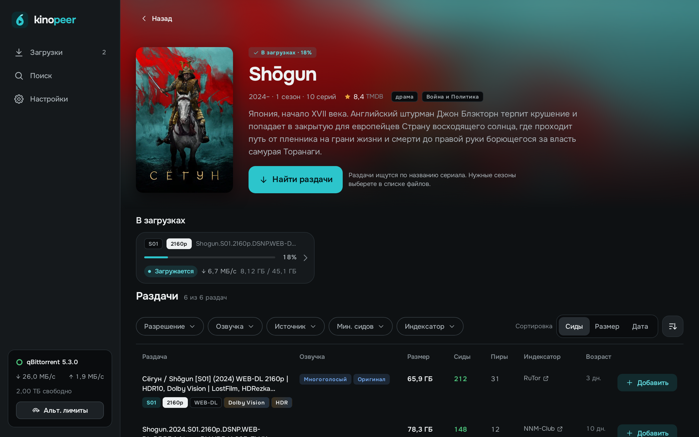
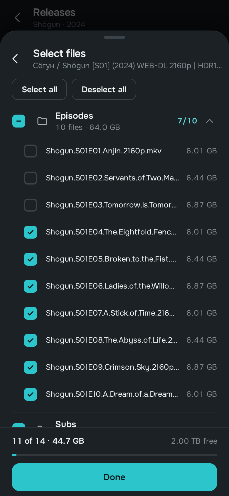
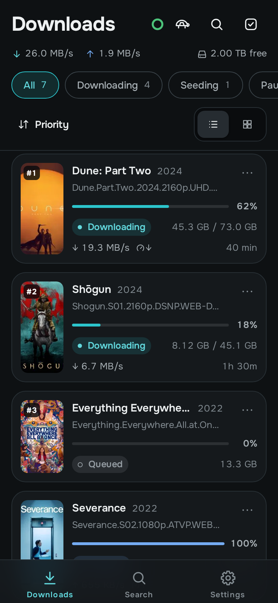
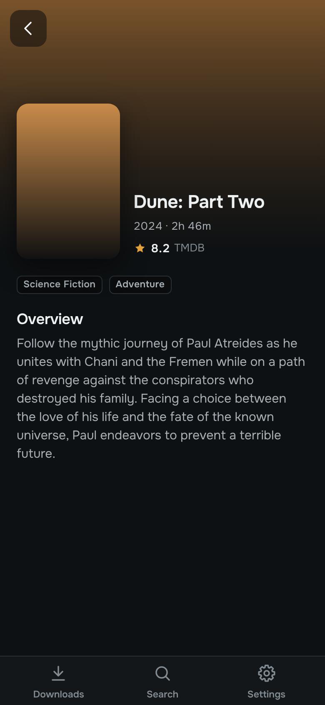
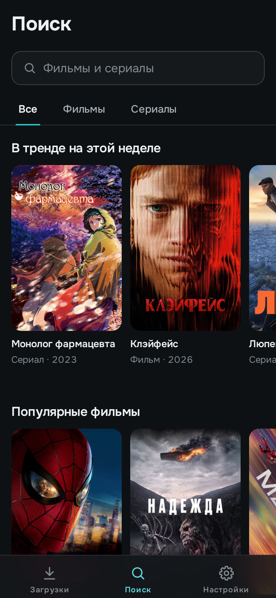

# Kinopeer

[](https://github.com/kinopeer/kinopeer/actions/workflows/ci.yml)
[](LICENSE)
[](https://github.com/kinopeer/kinopeer/releases/latest)

A qBittorrent web UI for movies and TV series. Find a movie or a series, pick a release found by Prowlarr and follow the download, all in one app on your phone or computer.

> [!NOTE]
> Kinopeer installs [on umbrelOS](#install-on-umbrel) or [with Docker Compose](#install-with-docker-compose). What's planned is in the [milestones](https://github.com/kinopeer/kinopeer/milestones).



<details>
<summary>More screenshots</summary>

<p>
  
  
  
</p>
<p>
  
  
  
</p>


</details>

## What it does

- **From a title to a release.** Find a movie or a series in TMDB, and Kinopeer searches every indexer in your Prowlarr. It reads each release's name for its resolution, source, HDR, voice-over and seasons, so the filters narrow the list down to the one you want.
- **Download only what you need.** The release goes to qBittorrent with your category and folder. Pick single files or seasons, and Kinopeer tells you beforehand whether they fit in the free space.
- **Downloads as a film collection.** Kinopeer recognizes each torrent's movie or series from its release name and shows it with a poster and a title instead of the release name; a wrong guess takes a moment to correct. A title's page shows what of it is downloading.
- **Managing torrents.** What you actually need when downloading movies and series, without opening qBittorrent's web UI: pause and delete, several torrents at once too, file priorities, speed limits, moving files, categories.
- **Know when it's done.** Kinopeer can send you a Telegram message, through a bot of your own, when a download you marked finishes.
- **Phone and computer.** A comfortable interface that fits both a phone and a computer. Multilingual, with dark and light themes.

Kinopeer doesn't play video and never downloads anything on its own: you pick every release.

Kinopeer comes with no content and no indexers: it searches only the indexers you add to Prowlarr yourself. Use it only for what you have the right to download.

## Install on Umbrel

It needs the **qBittorrent** and **Prowlarr** apps from the Umbrel App Store. It works with qBittorrent 4.6.0 or later.

1. Open **App Store** → the **⋯** menu at the top right → **Community App Stores**.
2. Paste `https://github.com/MrShakhov/umbrel-homelab-store` → **Add**.
3. Open **Homelab App Store** → **Kinopeer** → **Install**.
4. Kinopeer opens at `http://umbrel.local:8797`.

On first launch:

- **qBittorrent** connects on its own with Umbrel's default login. If you changed it, Kinopeer asks for the login once and keeps it on your Umbrel.
- **TMDB** needs no setup: Kinopeer uses its own key. You can enter your own free [TMDB API key](https://www.themoviedb.org/settings/api) in Settings; it's kept on your Umbrel, and TMDB calls then go to TMDB directly.
- **Prowlarr** needs no setup: Kinopeer reads its API key itself. Trackers are added as indexers in Prowlarr.

Umbrel offers updates when a new version is out. What changed is in [CHANGELOG.md](CHANGELOG.md).

## Install with Docker Compose

> [!NOTE]
> This works from Kinopeer 1.1.0, the first version with a password of its own.

Kinopeer's [`docker-compose.yml`](docker-compose.yml) runs Kinopeer beside **qBittorrent** (the qBittorrent project's own image) and **Prowlarr** (LinuxServer.io's image, which Prowlarr's wiki points to), each in a container of its own. It needs Docker with Compose.

1. In an empty folder, download the file from the latest release, make the folder for downloads and start it:

   ```bash
   curl -LO https://github.com/kinopeer/kinopeer/releases/latest/download/docker-compose.yml
   ```

   ```bash
   mkdir downloads
   ```

   ```bash
   docker compose up -d
   ```

2. Open Kinopeer at `http://<your server>:8797` right away and set its password: until then, whoever opens it first sets it. To set it beforehand, put `KINOPEER_PASSWORD='…'` with a password of 8 characters or more in a `.env` file next to `docker-compose.yml`, in single quotes, so that Compose keeps a `$` in it as it is.
3. Open Prowlarr at `http://<your server>:9696`, set up its login and add your indexers. Kinopeer reads Prowlarr's API key itself.

qBittorrent and TMDB need no setup. Downloads go into that `downloads` folder, `/downloads` inside qBittorrent, where Settings → qBittorrent folders sets qBittorrent's folders, and belong to whoever owns it, you when you made it. Should Docker make it instead, it's root's, and qBittorrent writes as user 1000 rather than as root. Rootless Docker and Podman show your own folder as root's too: there, put `PUID=0` and `PGID=0` in the `.env` file, which they map to you. The file confirms qBittorrent's legal notice for you, which qBittorrent asks for before it starts.

**qBittorrent trusts Kinopeer without a password, and nothing else.** On its first start, the file sets qBittorrent up to let in Kinopeer's container, at its fixed address `172.30.97.10`, without a password, so you don't need the temporary one qBittorrent makes up on every start until a password is set. Everyone else needs a password, and qBittorrent's own web UI isn't reachable from outside Docker. To have qBittorrent ask Kinopeer for a password too:

1. Uncomment the `8081:8080` line under `qbittorrent` in `docker-compose.yml`, run `docker compose up -d` and open `http://<your server>:8081`.
2. Sign in as `admin` with the temporary password from `docker compose logs qbittorrent`.
3. In **Tools → Options → Web UI**, set a password and turn off **Bypass authentication for clients in whitelisted IP subnets**.
4. Kinopeer then asks for qBittorrent's login once and keeps it.

**Settings**, all optional, go into the `.env` file:

| Variable | Default | What it sets |
| --- | --- | --- |
| `KINOPEER_PORT`, `PROWLARR_PORT` | `8797`, `9696` | Kinopeer's and Prowlarr's ports |
| `DOWNLOADS_DIR` | `./downloads` | The folder downloads go into |
| `KINOPEER_PASSWORD` | none | Kinopeer's password, in place of one set in the app |
| `KINOPEER_ALLOWED_HOSTS` | none | Names Kinopeer answers at besides the ones it answers at by default, such as a reverse proxy's domain ([which those are, and its rules](docs/DEVELOPMENT.md#server-configuration)) |

If `docker compose up` says the network's range overlaps another, change the range `172.30.97.0/24`, the part of it Docker gives the other containers (`172.30.97.128/25`) and Kinopeer's address `172.30.97.10`, in both places it's written, in `docker-compose.yml` before the first start. Keep Kinopeer's address in the range and out of that part.

**Updating:** `docker compose pull`, then `docker compose up -d`. Kinopeer's image follows the newest 1.x release, qBittorrent's and Prowlarr's their newest releases. A release that changes `docker-compose.yml` says so in [CHANGELOG.md](CHANGELOG.md); download it again then, keeping your `.env`.

**HTTPS** is up to a reverse proxy in front of Kinopeer, which this file doesn't include; here's an example, not a setup we support. Kinopeer answers only at names it knows, so add the proxy's domain to `KINOPEER_ALLOWED_HOSTS` (`KINOPEER_ALLOWED_HOSTS=kinopeer.example.com`), and have the proxy pass on the name the page was opened at, as Caddy does. With the proxy on the same machine, `KINOPEER_PORT=127.0.0.1:8797` keeps Kinopeer's own port to that machine, so it isn't also open over plain HTTP:

```
kinopeer.example.com {
	reverse_proxy localhost:8797
}
```

## On your phone

Kinopeer is a web app (PWA). Over plain HTTP on your home network it works in the browser, and on an iPhone or iPad you can add it to the Home Screen from Safari's Share menu to open it full screen. umbrelOS 2.0 also serves it over HTTPS (`https://umbrel.local:8797`): with the Umbrel certificate trusted on your device ([Umbrel's guide](https://umbrel.com/support/basics/accessing-your-umbrel-over-https)), Kinopeer installs as an app on Android and computers too and keeps its shell available offline. Umbrel renews that certificate every month: if your browser trusts it only because you accepted its warning (Safari's "Visit Website") rather than installing it, the installed app says it can't reach Kinopeer once the certificate changes, and **Open again** brings back the browser's warning to accept the new one.

## Privacy and security

- The TMDB and Prowlarr keys, the qBittorrent login and a Telegram bot's token stay on the Kinopeer server and never reach the browser.
- Besides your qBittorrent and Prowlarr, Kinopeer only talks to TMDB, and only through its own server. Without a TMDB key of your own, those calls go through Kinopeer's TMDB proxy on Cloudflare, which adds Kinopeer's key and sees your server's IP address and what you search for; it keeps no logs. With your own key in Settings, they go to TMDB directly. With Telegram notifications set up, the server also sends Telegram the finished download's title and release name. No analytics, no telemetry.
- Kinopeer never stores tracker logins: that's Prowlarr's job.
- Kinopeer has a password of its own, which the first visitor sets (or the server's `KINOPEER_PASSWORD`); on Umbrel, Umbrel's login protects it instead, and Kinopeer's is off. What it covers and what it doesn't: [SECURITY.md](SECURITY.md).
- Found a vulnerability? Report it privately, as [SECURITY.md](SECURITY.md) says.

## Ideas and bugs

- **An idea or a missing feature:** post it in [Discussions → Ideas](https://github.com/kinopeer/kinopeer/discussions/categories/ideas), or upvote one that's already there.
- **A bug:** [report it](https://github.com/kinopeer/kinopeer/issues/new?template=bug_report.yml) with the steps and your versions; Settings → About shows them.
- **A question about installing or using Kinopeer:** ask in [Discussions → Q&A](https://github.com/kinopeer/kinopeer/discussions/categories/q-a).

## For developers

- [CONTRIBUTING.md](CONTRIBUTING.md): ideas, bugs and pull requests.
- [docs/DEVELOPMENT.md](docs/DEVELOPMENT.md): running locally, server configuration, releases.
- [docs/SPEC.md](docs/SPEC.md): what the product does and why.
- [Milestones](https://github.com/kinopeer/kinopeer/milestones): what's next.

## License

Kinopeer is free software: you can redistribute it and modify it under the terms of the [GNU General Public License](LICENSE), version 3 or any later version. Copyright © 2026 Alfred Shakhov.

<a href="https://www.themoviedb.org"></a>

Movie and series data and posters come from [TMDB](https://www.themoviedb.org). This product uses the TMDB API but is not endorsed or certified by TMDB.

The Onest font is under the [SIL Open Font License 1.1](https://openfontlicense.org). TMDB's logo, and the posters and descriptions in the screenshots, belong to their owners and aren't covered by Kinopeer's license.
