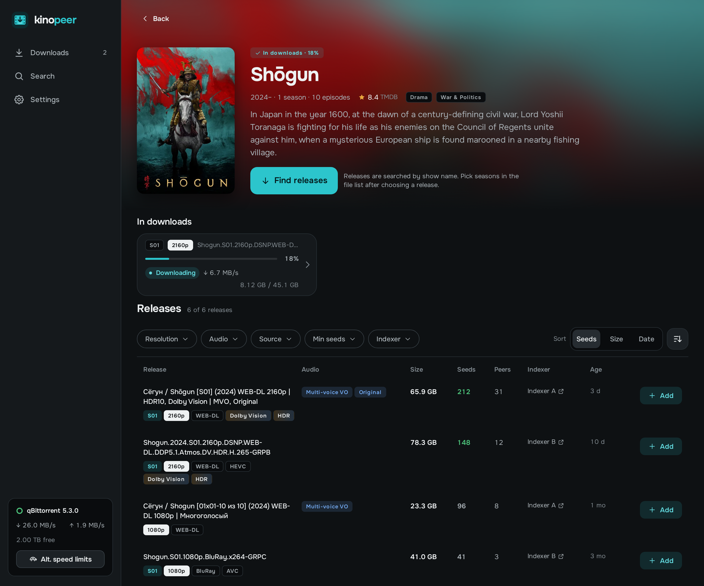
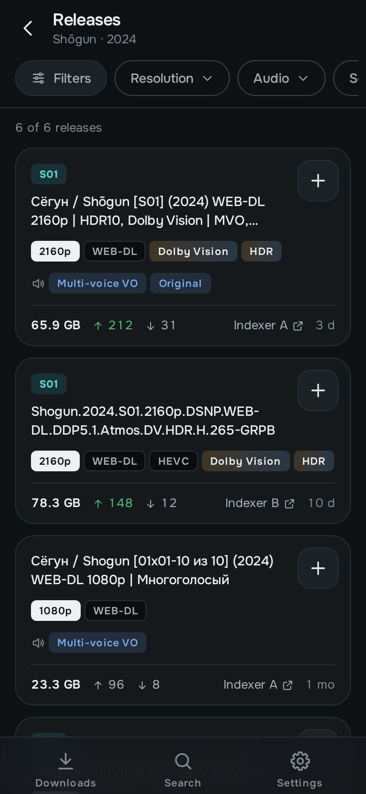
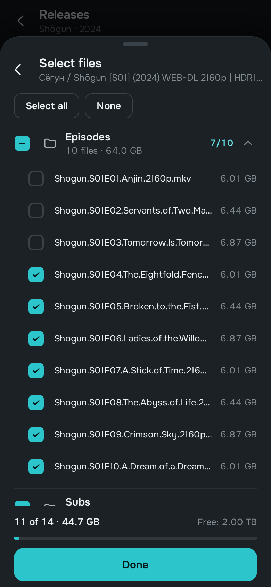
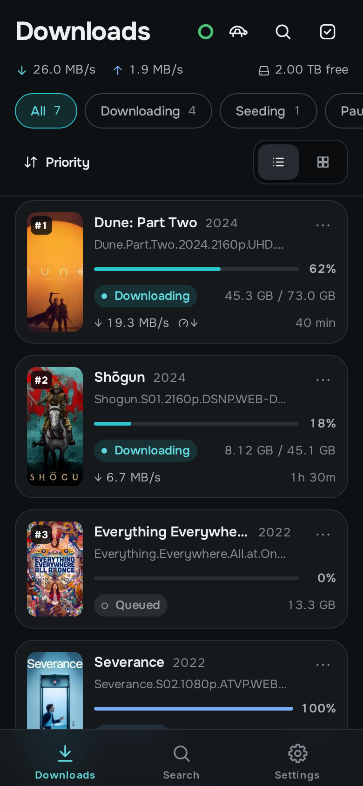
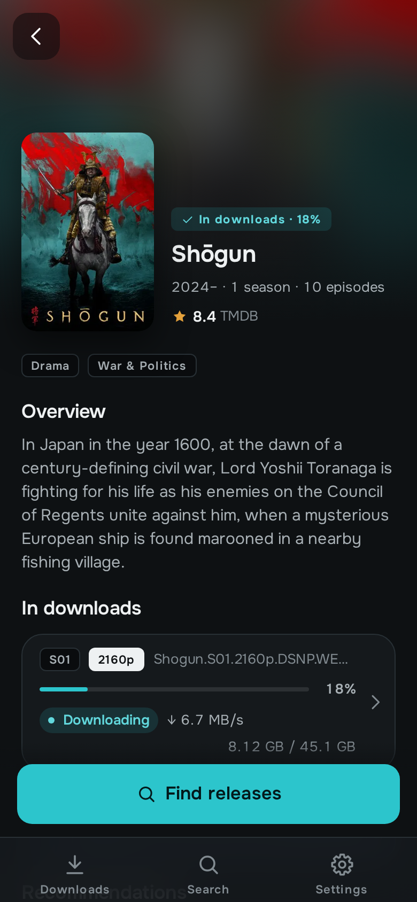
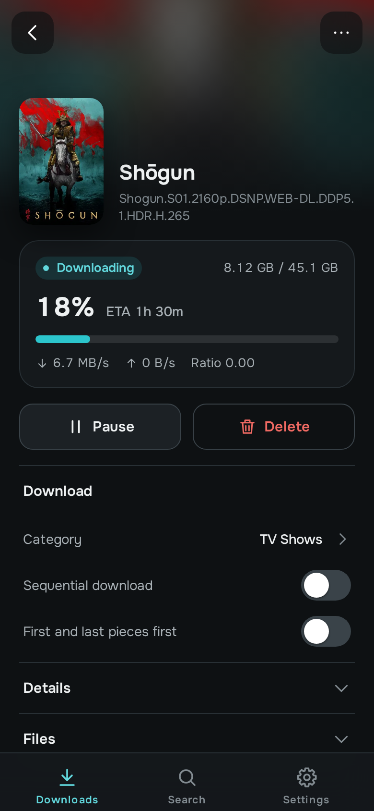
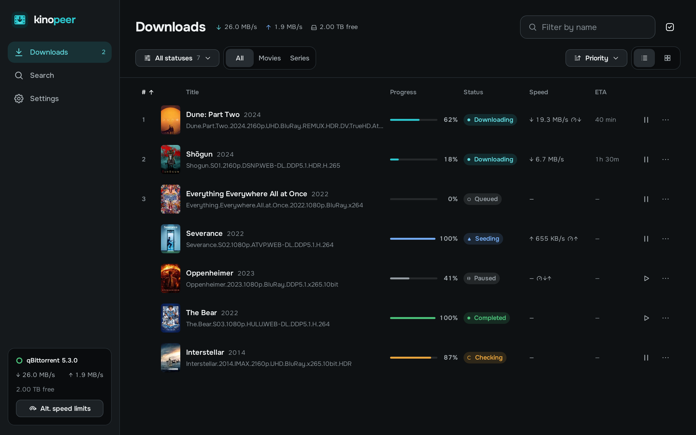

# Kinopeer

A qBittorrent web UI for movies and TV series. Find a movie or a series, pick a release found by Prowlarr and follow the download, all in one app on your phone or computer.

> [!NOTE]
> Kinopeer is in early development (version 0.x): for now it installs on umbrelOS only, and its settings and behavior may change between versions. What's planned before 1.0 is in the [roadmap](docs/ROADMAP.md).

  
  
  

  
  
  

## What it does

- **From a title to a release.** Find a movie or a series in TMDB, and Kinopeer searches every indexer in your Prowlarr. It reads each release's name for its resolution, source, HDR, voice-over and seasons, so the filters narrow the list down to the one you want.
- **Download only what you need.** The release goes to qBittorrent with your category and folder. Pick single files or seasons, and Kinopeer tells you beforehand whether they fit in the free space.
- **Downloads as a film collection.** Kinopeer recognizes each torrent's movie or series from its release name and shows it with a poster and a title instead of the release name; a wrong guess takes a moment to correct. A title's page shows what of it is downloading.
- **Managing torrents.** What you actually need when downloading movies and series, without opening qBittorrent's web UI: pause and delete, several torrents at once too, file priorities, speed limits, moving files, categories.
- **Phone and computer.** A comfortable interface that fits both a phone and a computer. Multilingual, with dark and light themes.

Kinopeer doesn't play video and never downloads anything on its own: you pick every release.

Kinopeer comes with no content and no indexers: it searches only the indexers you add to Prowlarr yourself. Use it only for what you have the right to download.

## Install on Umbrel

Kinopeer currently supports umbrelOS only. It needs the **qBittorrent** and **Prowlarr** apps from the Umbrel App Store.

1. Open **App Store** → the **⋯** menu at the top right → **Community App Stores**.
2. Paste `https://github.com/MrShakhov/umbrel-homelab-store` → **Add**.
3. Open **Homelab App Store** → **Kinopeer** → **Install**.
4. Kinopeer opens at `http://umbrel.local:8797`.

On first launch:

- **qBittorrent** connects on its own with Umbrel's default login. If you changed it, Kinopeer asks for the login once and keeps it on your Umbrel.
- **TMDB** needs no setup: Kinopeer uses its own key. You can enter your own free [TMDB API key](https://www.themoviedb.org/settings/api) in Settings; it's kept on your Umbrel, and TMDB calls then go to TMDB directly.
- **Prowlarr** needs no setup: Kinopeer reads its API key itself. Trackers are added as indexers in Prowlarr.

Umbrel offers updates when a new version is out. What changed is in [CHANGELOG.md](CHANGELOG.md).

## On your phone

Kinopeer is a web app (PWA). Over plain HTTP on your home network it works in the browser, and on an iPhone or iPad you can add it to the Home Screen from Safari's Share menu to open it full screen. umbrelOS 2.0 also serves it over HTTPS (`https://umbrel.local:8797`): with the Umbrel certificate trusted on your device ([Umbrel's guide](https://umbrel.com/support/basics/accessing-your-umbrel-over-https)), Kinopeer installs as an app on Android and computers too and keeps its shell available offline.

## Privacy and security

- The TMDB and Prowlarr keys and the qBittorrent login stay on the Kinopeer server and never reach the browser.
- Besides your qBittorrent and Prowlarr, Kinopeer only talks to TMDB, and only through its own server. Without a TMDB key of your own, those calls go through Kinopeer's TMDB proxy on Cloudflare, which adds Kinopeer's key and sees your Umbrel's IP address and what you search for; it keeps no logs. With your own key in Settings, they go to TMDB directly. No analytics, no telemetry.
- Kinopeer never stores tracker logins: that's Prowlarr's job.
- Kinopeer has no login of its own; on Umbrel, Umbrel's login protects it.
- Found a vulnerability? Report it privately, as [SECURITY.md](SECURITY.md) says.

## Ideas and bugs

- **An idea or a missing feature:** post it in [Discussions → Ideas](https://github.com/kinopeer/kinopeer/discussions/categories/ideas), or upvote one that's already there.
- **A bug:** [report it](https://github.com/kinopeer/kinopeer/issues/new?template=bug_report.yml) with the steps and your versions; Settings → About shows them.
- **A question about installing or using Kinopeer:** ask in [Discussions → Q&A](https://github.com/kinopeer/kinopeer/discussions/categories/q-a).

## For developers

- [CONTRIBUTING.md](CONTRIBUTING.md): ideas, bugs and pull requests.
- [docs/DEVELOPMENT.md](docs/DEVELOPMENT.md): running locally, server configuration, releases.
- [docs/SPEC.md](docs/SPEC.md): what the product does and why.
- [docs/ROADMAP.md](docs/ROADMAP.md): what's next.

## License

Kinopeer is free software: you can redistribute it and modify it under the terms of the [GNU General Public License](LICENSE), version 3 or any later version. Copyright © 2026 Alfred Shakhov.

Movie and series data and posters come from [TMDB](https://www.themoviedb.org). This product uses the TMDB API but is not endorsed or certified by TMDB.

The Onest font is under the [SIL Open Font License 1.1](https://openfontlicense.org). TMDB's logo, and the posters and descriptions in the screenshots, belong to their owners and aren't covered by Kinopeer's license.
